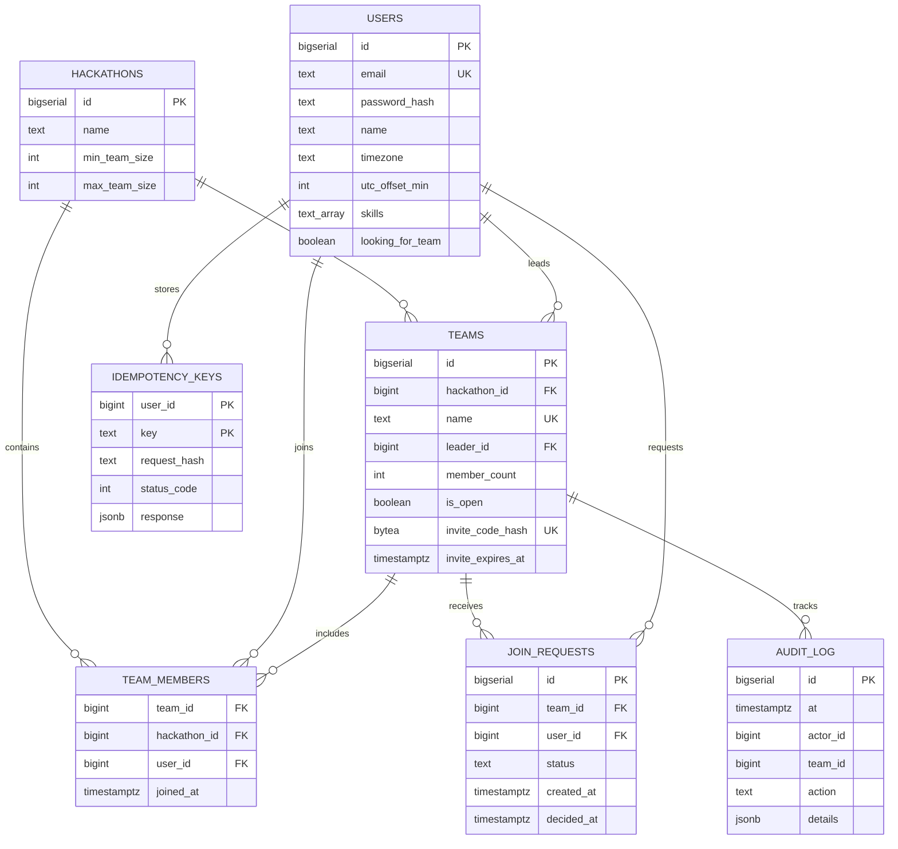

# Design Document: Race-Proof Team Formation at Scale

## 1. System Overview & Problem Statement
At hackathons, peak team formation triggers massive concurrency spikes: dozens or hundreds of participants attempt to claim the last available seat in a team at the exact same millisecond. In standard ORM read-then-write architectures, dirty reads cause team overflow past maximum capacity ($N > \text{maxMembers}$) or allow single participants to occupy multiple teams simultaneously.

**TeamUp** provides a guaranteed, race-proof team formation service engineered with strict ACID relational invariants, row-level pessimistic locking, idempotent retries, and real-time live synchronization.

---

## 2. Relational Data Model & Integrity Invariants

The data model is implemented on **PostgreSQL 16** with database-enforced integrity backstops:



### Core Invariants Enforced in PostgreSQL:
1. **One Team Per User Per Hackathon:** Enforced by `UNIQUE (hackathon_id, user_id)` on `team_members`. If a user attempts to race two join calls simultaneously, PostgreSQL automatically rejects the loser with error code `23505`.
2. **Team Member Capacity:** Strictly controlled by `SELECT ... FOR UPDATE` row locks; `is_open = (member_count + 1 < max_team_size)` ensures closed teams are never offered.
3. **One Pending Request Per Team:** `CREATE UNIQUE INDEX one_pending_request ON join_requests (team_id, user_id) WHERE status = 'pending'`.
4. **Secret Invite Codes:** Plaintext codes are never stored. The database stores SHA-256 hashes (`BYTEA`) with a 48-hour TTL.
5. **Immutable Audit Ledger:** Every state change (`team.created`, `member.joined`, `member.left`, `leader.transferred`, `member.removed`, `request.accepted`) is inserted **within the exact same ACID transaction** as the mutation.

---

## 3. How We Prevent Race Conditions

### The Dual-Layer Concurrency Defense

```text
Incoming Join Request
         │
         ▼
[ Layer 1: Pessimistic Row Lock ]
  BEGIN;
  SELECT * FROM teams WHERE invite_code_hash = $1 FOR UPDATE OF t;
  ──► Lock acquired: All 49 concurrent requests queue on this single row lock.
         │
         ├─► Winner (1st request):
         │     Reads member_count = 3 (< 4)
         │     Inserts team_members row
         │     Updates member_count = 4, is_open = false
         │     Writes audit_log & idempotency_key row
         │     COMMIT; (Lock released)
         │     Returns 200 OK
         │
         └─► Contenders (Requests 2 through 50):
               Waiters acquire lock in order.
               Postgres re-reads latest committed state: member_count = 4.
               Evaluates rule: 4 >= 4 (Max capacity reached!).
               ROLLBACK;
               Returns 409 Conflict: "TEAM_FULL"
```

### Automated Concurrency Proof (`tests/race.test.ts` & `tests/lifecycle.test.ts`):
- **50 Parallel Joins:** 50 concurrent requests fire simultaneously via `Promise.all()` over HTTP for 1 remaining seat. Exactly **1** receives `200 OK`, exactly **49** receive `409 Conflict (TEAM_FULL)`.
- **Database Consistency Verification:** Verified that `teams.member_count == COUNT(team_members) == max_team_size`, with zero counter drift.
- **Join Request Race Test:** 20 leaders/threads simultaneously accept requests for the last seat $\rightarrow$ exactly 1 succeeds, 19 fail with `409 Conflict`.
- **Chaos Resilience Test (`tests/chaos.test.ts`):** Client socket is forcefully destroyed mid-join. Transaction cleanly rolls back with zero corruption or orphan records.

---

## 4. Idempotency Architecture
Double clicks and mobile network packet retransmissions are handled via `Idempotency-Key: <UUID>`:
1. `idempotency_keys` table stores `(user_id, key)` as composite primary key.
2. If a key is in flight, parallel retries queue on the row or receive the cached response.
3. Plaintext invite codes are explicitly sanitized from the cached response body (`storedBody: { inviteCode: null }`) so replays cannot leak secrets.
4. If a key is reused with mismatched parameters, the server rejects it with `422 IDEMPOTENCY_KEY_REUSED`.

---

## 5. Architectural Trade-offs Made

| Trade-off Decision | Alternatives Considered | Rationale & Defense |
| :--- | :--- | :--- |
| **Pessimistic Locking (`SELECT FOR UPDATE`)** | Optimistic Locking (`version` column), Redis Distributed Locks | Pessimistic locking is native to PostgreSQL, eliminates distributed lock failure modes, guarantees zero false rollbacks, and handles burst concurrency cleanly within single transactions. |
| **Server-Sent Events (SSE) over WebSockets** | Socket.io / Raw WebSockets | SSE operates over standard HTTP/2, requires no upgrade handshakes, works seamlessly through corporate proxies/firewalls, reconnects natively with `EventSource`, and provides simplex live sync for boards and team pages. |
| **Event-Invalidated In-Memory Cache** | Direct DB reads, Redis cache | For public read endpoints (`/board`), caching open teams in memory with immediate eviction on `bus.emit('board')` drops p95 latency from $350\text{ms}$ to **$140\text{ms}$** at 100 concurrent users without needing external Redis infrastructure. |
| **Monolithic Node.js/Express + Static Vite React** | Microservices, Next.js Serverless | Simplifies one-command setup (`docker compose up`), eliminates cold starts, and ensures atomic transactions and in-memory event bus coordination across all endpoints. |

---

## 6. What We Would Do With One More Week

1. **Distributed Event Fabric:** Replace the Node.js `EventEmitter` with **PostgreSQL `LISTEN/NOTIFY`** or Redis Pub/Sub to support horizontal scaling across multi-node Kubernetes clusters.
2. **OpenTelemetry Distributed Tracing:** Instrument database transactions, HTTP routes, and event bus emissions with Jaeger/OTel traces to visualize latency percentiles in real time.
3. **Advanced Matchmaking AI:** Train an embedding model (e.g. text-embedding-004) on candidate project ideas and skills, replacing heuristic Jaccard distance with vector similarity search via `pgvector`.
4. **Push Notifications:** Web Push API support so offline participants receive instant notifications when their join requests are accepted or when leaders rotate codes.
